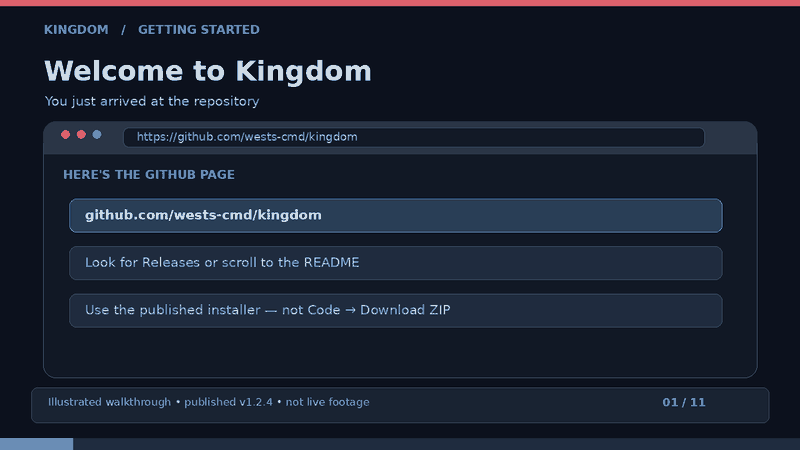

# Kingdom

## Install Kingdom — no terminal needed

**Choose your computer and click its installer.** This is the complete native desktop app; you do **not** need to clone the repository, install Python/Node/Docker, or choose **Code → Download ZIP**.

| Computer | Download Kingdom v1.2.9 (published) |
| --- | --- |
| Windows 64-bit (Intel/AMD) | **[Download Windows installer (.exe)](https://github.com/wests-cmd/kingdom/releases/download/v1.2.9/Kingdom-Setup-1.2.9.exe)** |
| Intel Mac (not Apple Silicon) | **[Download macOS installer (.dmg)](https://github.com/wests-cmd/kingdom/releases/download/v1.2.9/Kingdom-1.2.9.dmg)** |
| Linux 64-bit (Intel/AMD) | **[Download Linux AppImage](https://github.com/wests-cmd/kingdom/releases/download/v1.2.9/Kingdom-1.2.9.AppImage)** |
| Debian/Ubuntu 64-bit | **[Download Debian package (.deb)](https://github.com/wests-cmd/kingdom/releases/download/v1.2.9/kingdom-desktop_1.2.9_amd64.deb)** |

**Source vs installed app:** Published v1.2.9 includes the Quick Kingdom assistant and instant shortcuts. The new [Command Center](docs/COMMAND_CENTER.md) is a v1.2.10 source candidate, not included in the published v1.2.9 installers. A source merge never changes an installed copy.

**After downloading:** open the package, follow your operating system's normal install steps, then launch **Kingdom**. Follow guided setup, choose a profile, select **Runtime → Start Runtime**, and try **Tasks → Analyze text**. That first built-in task does not need an external AI model. Check its status and result.

These Windows/macOS packages are **unsigned**, and macOS is **not notarized**. Respect your operating system's security warnings; do not turn off security protections to force installation. Apple Silicon, Android APK and iOS IPA release packages are not supplied. [See all current release assets](https://github.com/wests-cmd/kingdom/releases/latest) and [troubleshooting steps](docs/GETTING_STARTED_VIDEO.md).

## Watch: Download and use Kingdom (beginner video)

[](https://github.com/wests-cmd/kingdom/blob/main/docs/media/kingdom-getting-started.mp4)

**[Watch the illustrated v1.2.6 install-and-first-task video (with narration)](https://github.com/wests-cmd/kingdom/blob/main/docs/media/kingdom-getting-started.mp4)** · [Read the step-by-step transcript](docs/GETTING_STARTED_VIDEO.md)

Start right here on the Kingdom GitHub page. The video shows where to click to get the published native installer, how to launch the app, configure a model when needed, start Runtime, run **Tasks → Analyze text**, and check the result. It uses illustrated v1.2.6 screens, not a live GitHub or app recording. The [current release](https://github.com/wests-cmd/kingdom/releases/latest) and your OS security protections remain authoritative; native Windows/macOS packages are unsigned.

## Overview

Kingdom is a standalone web and desktop command center for models, Apprentices,
governed tasks, shared knowledge and approved Knight computers. Its direction is
plan → place → execute → verify → remember → adapt. A connected computer or an
AI answer is not proof that a task completed.

**Current stable native downloads:** [Latest published Kingdom release](https://github.com/wests-cmd/kingdom/releases/latest).
The pinned installer links above point to v1.2.9; if a newer release is shown
above, use its assets and matching SHA-256 checksums. Source branches and
installed applications can differ.

**Security status:** v1.2.9 includes the prior compromise gate and final Docker-image dependency audit. These checks do not establish physical
multi-computer security acceptance or OS signing. See [open security acceptance](https://github.com/wests-cmd/kingdom/issues/172).


### Install the desktop app

The **four matching, one-click downloads are at the top of this README**. Open the selected package; native releases include the backend runtime. Do not download the source ZIP or a backend-only executable when you want the desktop app.

For integrity checks, use the [v1.2.9 SHA256SUMS](https://github.com/wests-cmd/kingdom/releases/download/v1.2.9/SHA256SUMS) and [release manifest](https://github.com/wests-cmd/kingdom/releases/download/v1.2.9/release-manifest.json). The macOS package targets **Intel**; Windows/macOS are unsigned, and the Mac package is not notarized. These packages are not ARM64 or mobile releases. If app-control blocks the install, do not bypass protections: see [beginner troubleshooting](docs/GETTING_STARTED_VIDEO.md) or [report a problem](https://github.com/wests-cmd/kingdom/issues).

You can test built-in text analysis without a model. For model-generated answers, configure and test a supported provider under **Routing**. An optional local opening passcode starts disabled; pairing and owner access require separate authorization. [Mission guide](docs/MISSION_WORKSPACE.md).

## Project map

| Piece | Authoritative files | Role |
| --- | --- | --- |
| Web interface | [frontend](frontend), [Vite configuration](frontend/vite.config.js) | React UI; development port 5173; built assets served by the backend |
| API and runtime | [backend/main.py](backend/main.py), [backend/api.py](backend/api.py), [runtime](backend/runtime) | FastAPI, scheduling, policy, tasks and SQLite evidence |
| Connected computers | [backend/cluster](backend/cluster) | Signed peer communication, approvals, capabilities and leases |
| Desktop shell | [desktop](desktop) | Electron wrapper around the bundled loopback backend |
| Companion clients | [apps/mobile](apps/mobile) | Separate web/native companion source and pairing flows |
| Packaging and checks | [scripts](scripts), [.github/workflows](.github/workflows), [tests](tests) | Builds, validation, release and regression evidence |

See [architecture](docs/ARCHITECTURE.md) for request flow and boundaries. Runtime
layout and existing imports stay intact; documentation navigation is the common
entry point rather than a second application tree.

## Run locally

Source development uses Python 3.12 and Node.js 24, matching CI. From the repo root:

```bash
python3 -m venv venv
source venv/bin/activate
python -m pip install -r requirements-dev.txt
npm --prefix frontend ci
npm --prefix frontend run build
python -m uvicorn backend.main:app --host 127.0.0.1 --port 8000
```

Open `http://127.0.0.1:8000/`. In PowerShell, use `python` and activate with
`venv\Scripts\Activate.ps1` instead. Build the frontend **before** starting the
backend so its static routes find `frontend/dist`. The working directory owns
the source-run `data/` directory. [Development guide](docs/DEVELOPMENT.md) covers
the optional separate Vite server and desktop packaging prerequisites.

## Configuration

The backend reads process environment; copying [.env.example](.env.example)
does not establish that a launcher loads it. Source administrative requests use
`data/owner-token` or `KINGDOM_OWNER_TOKEN`. Keep these private and outside tasks,
maps, source control and public chats. `ALLOWED_ORIGINS` controls browser origins;
frontend development can use `VITE_API_URL` for an explicitly selected backend.
Provider selection, existing grants and autonomy are separate controls.
[Operations and configuration](docs/OPERATIONS.md).

Source also includes opt-in [planning help and retained lessons](docs/PLANNING_HELP.md):
verified local reuse, optional owner-connected ChatGPT advice, and selected local
training exports. It starts disabled and does not establish an installed fleet
update or a complete autonomous coding-and-release loop.

## Verification

Documentation navigation: `python scripts/check_docs.py` (Python 3 standard library). CI checks the same local targets and required README sections; it does not check external URLs or prove runtime completion.

With development dependencies installed and web assets built:

```bash
python -m pytest
node --test frontend/tests/*.test.js apps/mobile/mobile-client.test.js
python scripts/validate_version.py
```

These commands do not prove physical-device connectivity or installed updates.
Use the [cluster shipping checklist](docs/CLUSTER_SHIPPING_CHECKLIST.md) and
[release process](docs/RELEASE_PROCESS.md) for those separate gates.

## Operations and updates

Windows v1.2.1+ exposes **Settings → Desktop updates**. macOS/Linux use their
matching package. Back up data before updates; verify the exact installed source
and rollback path. Publishing a release does not update every Knight.
[Operations](docs/OPERATIONS.md), [containers](docs/docker-cluster.md),
[vault/device layout](docs/VAULT_AND_DEVICE_LAYOUT.md).

## Integrations

[Centipede OS](https://github.com/wests-cmd/Centipede-os) is a separate application
and OS-image project. Configure its connection explicitly; installing either
product does not install, trust or authorize the other. Models, CLI harnesses,
Discord adapters, public APIs and portable skill maps are optional integrations.
Maps and community membership grant no execution authority.
[Integration boundaries](docs/ARCHITECTURE.md#integrations).

For another device, use a reachable trusted HTTPS server, create a single-use
pairing code and approve it. `localhost` on a phone refers to the phone.
[Device connections](docs/device-connections.md).

## Status and roadmap

The published release supports bounded governed work, programmes, scoped peer
reports and analysis tools. General autonomous repository coding, automatic
installation on every Knight, universal self-repair and broad hardware support
remain separate acceptance work. [Current status](docs/PROJECT_STATUS.md),
[architecture direction](docs/ADAPTIVE_CLUSTER_CORE.md), [roadmap](docs/HARNESS_ROADMAP.md).

## Documentation

Start at the [documentation index](docs/README.md): setup, development,
operations, integration, verification and historical reports have separate homes.
Use [GitHub Issues](https://github.com/wests-cmd/kingdom/issues) for reproducible
bugs and [Kingdom Discord](https://discord.gg/4b8f9YS2Wp) for community help.
Never post credentials or private linking codes. [Community guide](docs/COMMUNITY_GUIDE.md).

## License

Read the [CYA License v2.0](LICENSE) and [commercial-use policy](COMMERCIAL_USE.md).
