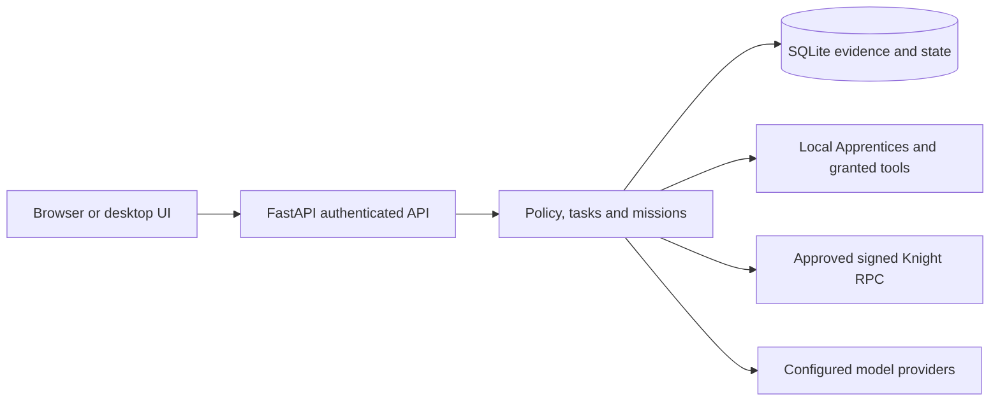

# Kingdom architecture

## Product boundary

Kingdom runs independently as a FastAPI service with a React web interface, or
inside an Electron desktop package. The current entry points are
[`backend/main.py`](../backend/main.py), [`frontend/src`](../frontend/src),
[`desktop/main.js`](../desktop/main.js) and the separately built
[`apps/mobile`](../apps/mobile) companions.

## Files and flow

| Concern | Source | Boundary |
| --- | --- | --- |
| HTTP routes and startup | [`backend/main.py`](../backend/main.py), [`backend/api.py`](../backend/api.py) | App lifecycle, routers, authentication and static UI |
| Governed execution | [`backend/runtime`](../backend/runtime) | Separate owner policy, task/mission state, backlog and programme planning |
| Persistence | [`backend/storage`](../backend/storage) | SQLite task versions and retained evidence; do not edit an active database directly |
| Cluster communication | [`backend/cluster`](../backend/cluster) | Identity, pairing, capabilities, leases, fencing and typed observations |
| Models and tools | [`backend/models`](../backend/models), [`backend/integrations`](../backend/integrations) | Configured providers and individually granted operations |
| Frontend API address | [`frontend/src/backendConfig.js`](../frontend/src/backendConfig.js) | Explicit backend origin; a URL is not authorization |
| Desktop lifecycle | [`desktop/main.js`](../desktop/main.js) | Packaged loopback backend and window/update lifecycle |

The source service normally uses loopback port 8000; Vite development uses 5173.
The backend serves `frontend/dist` when it is built before startup. Electron
loads its loopback backend, and the mobile companion has separate reachable-URL
and pairing requirements. No second undocumented web server is needed.

## Authority and verification

Human authority precedes policy, security, execution and models. A model can
propose a task, never grant itself a capability or establish successful execution.
Authentication, autonomy, placement and computer capabilities are independent.
Task/lease evidence is different from a reported heartbeat or visual group.
Source-declared revisions and passing command summaries have the limits stated
in [project status](PROJECT_STATUS.md) and [shipping gates](CLUSTER_SHIPPING_CHECKLIST.md).

## Integrations

- Centipede is a separate web/backend/OS-image project. Its configured connection
  reaches Kingdom's authenticated API; it is not the same process or storage.
- Model endpoints must be explicitly configured. Installing weights, choosing
  a profile and granting a tool are different actions.
- External CLI harnesses, Discord linking and portable skill documents remain
  optional adapters. Do not infer task dispatch from a document import.
- Each independent service keeps its own credentials, startup, health and data
  lifecycle. Share documented schemas/API calls rather than importing another
  repository's internal modules or relying on a sibling directory.

See [Discord boundary](DISCORD_SKILLMAPS.md), [portable skills](PORTABLE_SKILLS.md),
[device setup](device-connections.md) and [workspace/peers](WORKSPACE_AND_PEER_KINGDOMS.md).
