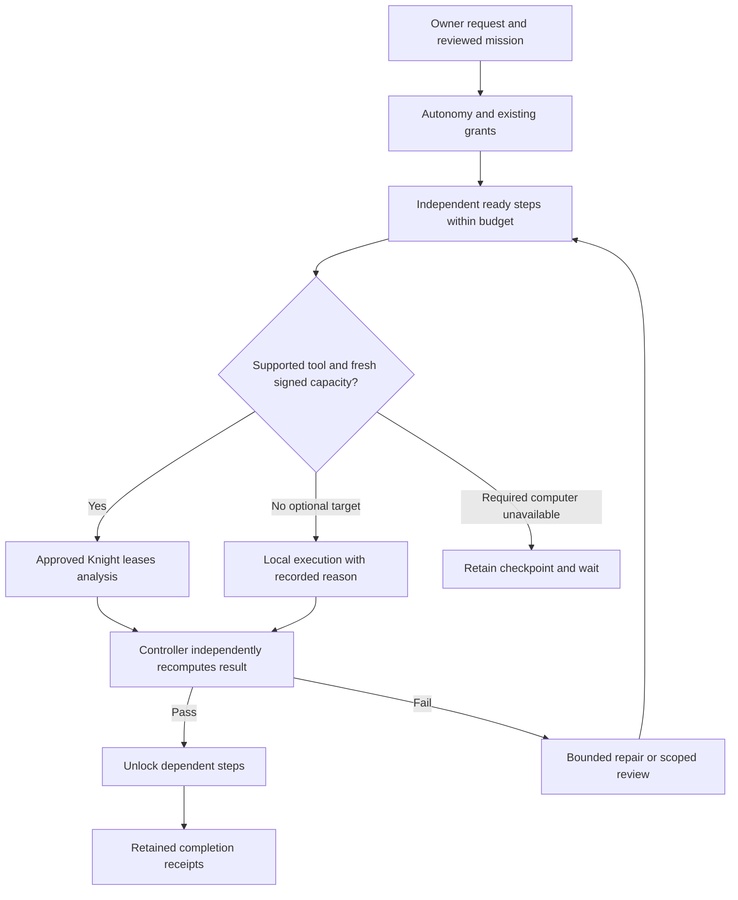

# Computers, agents and coordination

Kingdom is the whole coordinated system. A Knight is a computer. An Apprentice is an agent hosted on a Knight. Public labels use `Apprentices-coder`; old `knight-coder` routing identities remain compatible with existing records.

Swarm's Network map and Nodes & Cluster show the same reported computers and their Apprentices. Fresh signed inventories contribute to totals; an unavailable inventory is unknown rather than zero. Open a computer to inspect its agents and observed services.

The editable coordination graph records reporting relationships separately from hosting. Drag a card onto a coordinator or use its menu, then save. Level means depth in that graph, not the owner's autonomy level. Edits cannot grant tools, migrate agents, change a computer's identity, or authorize a payment. The owner-only endpoint rejects cycles, unknown entities and stale editor revisions. Keyboard menus provide the same edit path as dragging.

Reporting lines currently support organization and inspection. They do **not** automatically create Captain groups or change mission placement. Captain groups and exact-computer mission targets retain their existing authority checks. Connecting those controls to graph edits is separate unfinished work.

L4 supports 40 steps and L5 supports 100, with at most three ready steps at L5. A larger budget is not evidence of autonomous coding quality. Each step needs verified results. Syntax checks establish valid syntax, not application correctness. Model output or a successful process exit does not establish a tested repair.

Federation heartbeats include measured CPU and memory load. Missing or invalid measurements clear old capacity rather than refreshing an idle claim. The existing 45-second freshness limit and capability checks remain. Signed inventory transport alone does not execute queued work; an approved task worker or owner-operated analysis relay must also be running.

The native desktop shell now hides to its tray on close and stops its owned backend only on explicit Quit. This lifecycle has automated tests; packaged Windows tray interaction still needs device acceptance. A remote server also needs its own persistent service, and private SSH forwards need their separate owner-configured connection supervisor.
