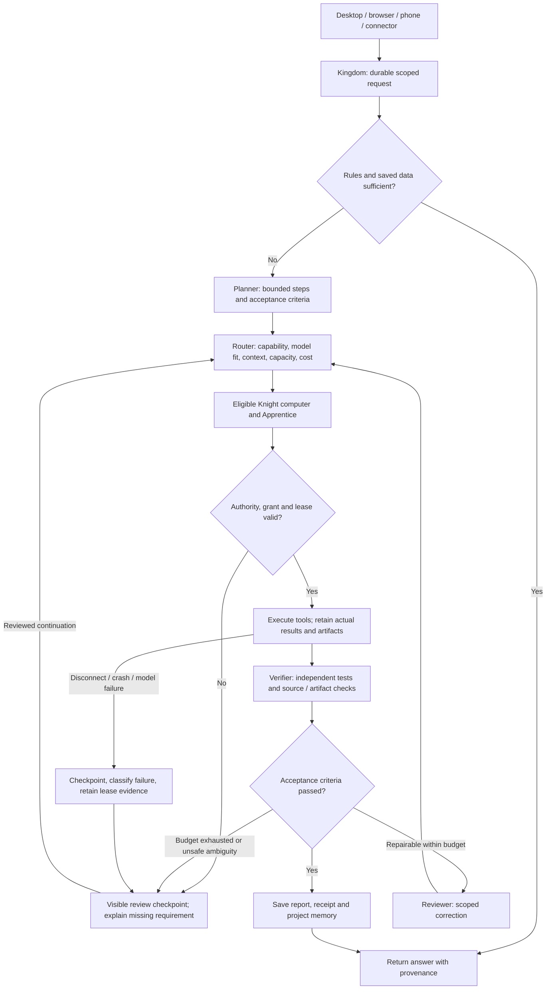

# Kingdom: visible orchestration across computers

Kingdom owns the request, plan, placement, execution evidence, review and memory. A Knight is a computer; an Apprentice is a software worker on a computer. A model connection is not another Knight. Two Kingdom installations keep separate identities and can offer approved work to each other.

## Request flow

## Roles, contracts and decisions

| Role | Inputs | Outputs | Decision logic |
| --- | --- | --- | --- |
| Kingdom orchestrator | Owner request, project scope, policy, checkpoint | Persistent request and bounded run | Rules first; otherwise delegate. Enforce budgets and isolate projects. |
| Planner Apprentice | Objective and acceptance criteria | Small dependency steps | Ask for missing source or requirements; do not invent access. |
| Router | Tool requirements, model context, eligible computers, capacity and measured outcomes | Selected model/profile and executor | Reject missing grants, stale peers, insufficient context and saturated hosts. Model size alone is not a quality score. |
| Knight executor | Exact step, granted capabilities, valid lease | Actual tool outcomes, changed artifacts and checkpoints | Execute only the permitted operation. Return signed results for remote work. |
| Coding / research Apprentice | Relevant source or references, scoped tools | Patch, analysis or findings | Treat retrieved text as data; preserve tests and unrelated changes. |
| Verifier | Original acceptance criteria, diff, source hashes and retained test outputs | Passed checks or explicit failures | Model claims, a zero exit and a completed response do not by themselves establish a tested repair. |
| Reviewer | Failed checks and remaining budget | Accept, request a narrow correction or stop | Bound repair attempts; never retry ambiguous side effects automatically. |
| Memory Apprentice | Accepted reports, notes, receipts and scope | Readable portable project memory | Index provenance; exclude secrets; never relabel unverified drafts as facts. |

These roles describe the target workflow. Installed tools and independently verified outcomes determine which steps a specific deployment can currently perform. A planner label does not prove a model is running.

## Visible state and current implementation

- Dashboard and Swarm show actual computer counts, local Apprentice counts, request state, actual selected model where retained, assigned executor, verified tools and blockers. Remote Apprentice inventory is not guessed.
- A background start uses an available server slot, existing request permissions, at most two model turns and a five-minute agent budget. Closing the browser does not stop the server operation. It pauses for review rather than running an endless correction loop.
- Graceful shutdown checkpoints background work. An abrupt server loss is shown as interrupted rather than silently replaying a potentially side-effecting operation.
- Durable requests, native agent tools, capability grants, signed remote native results and the reconnect fix exist. General autonomous repository repair, independent peer review, distributed model inference and automatic training are not established by those features.
- The recent six-project handoff stopped at review. The dashboard must expose the agent reason, not imply the batch is still working.

## Failure handling, optimization and scaling

Use rules or saved facts when adequate, then small eligible models, then tool-capable agents. Apply admission limits per model pool and computer, overlap network waits, and put CPU-heavy computation on suitable workers rather than expecting async code to accelerate it. Use measured latency, success and memory data; decline a model that cannot fit its actual prompt and tools.

Scope retries by failure class. A disconnected pure analysis may be requeued after lease recovery; an ambiguous external side effect needs review. A read timeout may leave inference running: avoid sending a duplicate generation blindly. Preserve partial text/file delivery checkpoints and identify ambiguous acknowledgements. On context exhaustion, reduce the task or select a fitting configured model without disabling its safeguards.

At larger scale, keep the authoritative durable queue and leases, reserve capacity atomically, use idempotency keys and bounded fan-out, and expose saturation and queue age. Move from one server background slot only after independent concurrency and recovery tests. A peer offline state must not be counted as spare capacity. Signing verifies identity, not answer correctness.

## Interface decisions from the references

- Closure: bounded scroll areas show the continuation of the next work card where space permits; never hide all work behind a single status banner.
- Figure and ground: selected-worker detail has a visible border and clear heading; task focus stays separate from decorative backgrounds. Do not dim important status text.
- Banner blindness: failures appear beside the affected request, not as promotional-looking banners.
- Reuse known information: show saved project, model and computer identity; keep automatic model routing as the default rather than asking users to retype known settings.
- Connectedness: display the request → route → executor → evidence → review sequence. Associate every result with the worker and project that produced it.
- Progressive choice: three work filters up front, with IDs and technical details in disclosures. Preserve keyboard access and explicit status text.

Half-width layouts use wrapping card sections, zero minimum widths in flexible tracks, Unicode-safe text wrapping and responsive worker rows. Validate compact and wide layouts; do not claim the reference screenshots' conversion or contrast numbers as measured Kingdom results.

## Kingdom and Codex

Codex supplies an agent harness with coding tools and execution/review surfaces. Kingdom is this project's model-agnostic orchestrator and distributed runtime: it places work across its approved computers, model connections and optional external harnesses. They can be composed through an adapter. Installing an adapter does not confer that harness's model quality, tool permissions or account access.

Current Kingdom has verified scoped file reads, native remote analysis and retained test receipts. Its local Hermes repair trials read source but did not produce accepted edits. This is a deployment limitation, not proof that every Kingdom installation is limited to those operations. More capable configured models, fitting context, correct grants and validated execution paths are required before claiming Codex-equivalent coding reliability.

Official OpenAI context: https://developers.openai.com/blog/codex-as-a-platform and https://developers.openai.com/learn/codex . This comparison does not imply a benchmark or capability parity.
